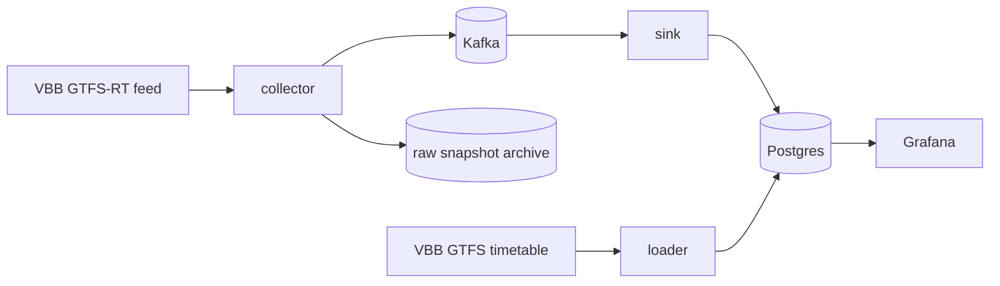

# umstieg

In Berlin, a late S-Bahn or U-Bahn often means a missed connection, and you only find out on the platform. umstieg reads live VBB data, learns how delays develop, and will warn riders early when a connection is about to break, with a better alternative.



**Status**
- Phase 1 (data in): in progress. Research, decisions and the build/infra skeleton are done.
- Next: a raw snapshot collector, so history starts building.
- Phases 2–4 (prediction, product, extras): not started.

## Run it

Needs Docker and Java 21.

```bash
make up     # starts Kafka + Postgres, waits until healthy
make test   # ./gradlew build
make down
```

## Docs

- [Data sources](docs/data-sources.md): what VBB publishes, limits, licence, reliability
- [Decisions](docs/decisions/README.md)

Data: VBB Verkehrsverbund Berlin-Brandenburg GmbH, [CC BY 4.0](https://creativecommons.org/licenses/by/4.0/).
