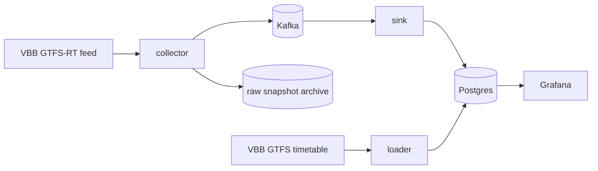

# umstieg

umstieg estimates how likely a transfer between S-Bahn, U-Bahn, tram and bus in Berlin is to work, and publishes how accurate the VBB realtime forecasts really are.

In Berlin, a late train often means a missed connection, and you only find out on the platform. umstieg reads live VBB data, learns how delays develop, and will warn riders early when a connection is about to break, with an alternative.



**Status**
- Phase 1 (data in): in progress. The raw collector is built: it saves both VBB feeds, alerts on Telegram when one goes stale, and packs each day into one archive for a public Hugging Face dataset.
- It is not deployed on the VPS yet, so history hasn't started. Next: deploy it, then the forecast quality report.
- Phases 2–4 (prediction, product, extras): not started.

## Run it

Needs Docker and Java 21.

```bash
make up     # starts Kafka + Postgres, waits until healthy
make test   # ./gradlew build
make collector  # polls the feed, writes to data/raw
make pack       # packs yesterday into data/archive
make upload     # uploads archives to Hugging Face, then removes them locally
make down
```

## Docs

- [Data sources](docs/data-sources.md): what VBB publishes, limits, licence, reliability
- [Decisions](docs/decisions/README.md)

Data: VBB Verkehrsverbund Berlin-Brandenburg GmbH, [CC BY 4.0](https://creativecommons.org/licenses/by/4.0/).
